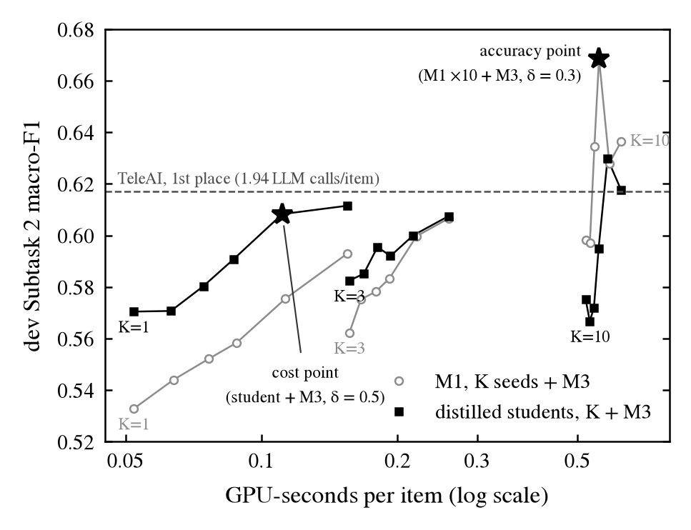
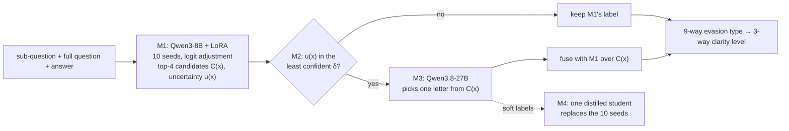

# Knowledge over Structure: Response Clarity Classification in Political Interviews

**SemEval-2026 Task 6 (CLARITY): Unmasking Political Question Evasions**

Siddarth Gottumukkula, Vidvathama R, Sanjana Reddy Vonteri, Shashikanta Sahoo<br>
Advanced NLP course project, International Institute of Information Technology, Hyderabad

> **Status: experiments closed (2026-10-30); final report and slides due 2026-10-31.** The mid-evaluation is
> complete ([report](report/mid_evaluation_report.pdf), [slides](report/mid_evaluation_slides.pdf)). After it,
> the system below became a measurement instrument for a research question, *is evasion in the question or in the
> answerer?* (E24–E25). **Start with [`docs/documentation.md`](docs/documentation.md)**: every experiment, why it
> was run, and how each led to the next. All numbers are on the official dev set.

---

## Overview

Given a journalist's question and a politician's answer, the task is to classify how clearly the
answer responds. Subtask 2 assigns one of nine evasion types (Explicit, Implicit, Dodging, General,
Deflection, Partial/half-answer, Declining to answer, Claims ignorance, Clarification). Subtask 1
groups them into three clarity levels (Clear Reply, Ambivalent, Clear Non-Reply). Scoring is macro-F1,
and a prediction counts as correct if any annotator gave that label.

We ran a controlled study of what limits a fine-tuned classifier on this task, then built a
confidence-routed cascade on the result:

- **Controlled encoder study.** On DeBERTa-v3-large, every change was tested against a named control
  on paired seeds: hierarchical heads, rebalancing losses, specialist experts, re-rankers, model soups
  and decision rules. Beyond logit adjustment, only longer training and adding the full question
  helped (0.315 → 0.384 Subtask 2 macro-F1 per model); the structural changes did not.
- **Knowledge over structure.** Changing only the backbone to Qwen3-8B-Base + LoRA, with the same
  data, input and selection rule, gained more (+0.092 per model, 10/10 seeds up) than all
  encoder-side changes combined (+0.069).
- **A cascade that asks a bigger model only when unsure.** The 8B classifier ranks better than it
  decides: an acceptable label is first for 60% of items but in its top 3 for 93%. A 27B LLM picks
  among the top four candidates for only the least confident items.
- **Distillation for cost.** One student trained on the LLM's soft labels replaces the 10-seed
  ensemble. With the LLM on half the items, it beats the 10-seed classifier at 0.27× its GPU cost.

## Results (dev, 308 items)

| System | Subtask 2 | Subtask 1 | LLM calls / item | GPU-s / item |
|---|---|---|---|---|
| DeBERTa-v3-large, 10-seed ensemble | 0.405 | 0.648 | 0 | – |
| Qwen3-8B + LoRA, 3 epochs, 10 seeds (mid-evaluation) | 0.543 | 0.746 | 0 | – |
| M1: Qwen3-8B + LoRA, 12 epochs, 10 seeds | 0.598 | 0.743 | 0 | 0.522 |
| **Accuracy point:** M1 + LLM adjudicator, 30% deferred | **0.650** | **0.788** | 0.36 | 0.576 |
| **Cost point:** distilled student + LLM adjudicator, 50% deferred | **0.608** | **0.785** | 0.57 | 0.139 |
| TeleAI (1st place), multi-stage DeepSeek-V3 pipeline | 0.617 | 0.812 | 1.94 | – |
| One human annotator scored against the other two (2-annotator regime) | 0.684 | – | – | – |

Every system averages seeds and applies logit adjustment. Its parameters (and the fusion weights of the
adjudicator) are fitted by nested cross-validation on dev, and test labels were never released.

The two operating points are the final system (E23).
- **One copy of the LLM throughout:** the adjudicator is a single serving of Qwen3.8-27B-FP8, with its answer
  averaged over four orderings of the candidate labels.
- **The earlier figure:** the same weights served on our lab server gave 0.669 for the accuracy point. The two
  copies disagree on 7.5% of decisions.
- **The test predictions** (`submissions/E23_*`) use test answers cleaned of transcript artifacts.

How sure we are of the adjudicator's gain over M1:
- **With the fitted parameters held fixed,** the gain is +0.067, 95% bootstrap interval [+0.009, +0.124].
- **With them refitted inside each bootstrap replicate,** it is +0.037 [−0.044, +0.120].
- **Averaged over smaller seed subsets,** it is +0.02 to +0.04.

The official test has two annotators per item. Under that regime, the accuracy point scores 0.589,
against 0.684 for one human annotator scored against the other.

<p align="center">
  
</p>

## Method



| Module | Role |
|---|---|
| **M1** Candidate generator | Fine-tuned Qwen3-8B-Base (LoRA) ensemble; outputs the top-4 label set and an uncertainty score |
| **M2** Router | Sends only the δ least confident items onward; the threshold is set on a held-out train slice |
| **M3** LLM adjudicator | A local 27B LLM chooses among M1's four candidates with one output token; its distribution is fused with M1's |
| **M4** Distillation | M3 relabels train; a single student trained on 0.5 · gold + 0.5 · M3 replaces the ensemble |

The protocol behind every number: hypotheses are registered before each run, every change is compared
against a named control on paired seeds, and every reported value traces to a script and a raw output
file ([`docs/04_results_sources.md`](docs/04_results_sources.md)).

## Repository structure

```text
├── code/                  source code (run every command from here)
│   ├── qevasion/          data loading, labels, official-scorer replica
│   ├── models/            DeBERTa encoder, Qwen3-8B + LoRA classifier, encoder variants
│   ├── cascade/           M1 candidates, M3 adjudicator, fusion, frontier, M4 distillation targets
│   ├── decision_rules/    seed ensembling and logit adjustment
│   ├── evaluation/        metrics, run comparison, submission packaging
│   ├── preregistered_analyses/   the analyses behind each reported number
│   ├── figures/           report and slide figures
│   ├── experiments/       run lists for each experiment
│   └── launch/            run queue and cloud GPU launchers
├── data/                  task evaluation file, fixed splits, cached train and dev
├── docs/                  experiment log, research narrative, code guide, raw outputs, figures
├── logs/                  training and pipeline logs of every run
├── report/                mid-evaluation report and slides, with LaTeX source
├── runs/M4/               distillation targets (all other run outputs are on Hugging Face)
└── submissions/           Codabench predictions: the DeBERTa systems, the cascade (E19_*), the final system (E23_*)
```

## Getting started

```bash
pip install -r requirements.txt
cd code
python -m preregistered_analyses.e13_analysis     # after fetching the published runs (see below)
```

The train and dev data download automatically. To re-run the analyses without a GPU, fetch the
per-seed probabilities from Hugging Face. [`docs/reproducing.md`](docs/reproducing.md) covers this,
training and the cascade. [`docs/code_guide.md`](docs/code_guide.md) describes every module.

## Resources

| | |
|---|---|
| Trained runs (per-seed probabilities, metrics, LoRA adapters) | [huggingface.co/siddarthg44/clarity-semeval26](https://huggingface.co/siddarthg44/clarity-semeval26) |
| Training curves | [wandb.ai/iamsid44-iiit-hyderabad/clarity-semeval26](https://wandb.ai/iamsid44-iiit-hyderabad/clarity-semeval26) |
| Dataset (QEvasion) | [huggingface.co/datasets/ailsntua/QEvasion](https://huggingface.co/datasets/ailsntua/QEvasion) |
| Full experiment record | [`docs/`](docs/) |

## References

- Konstantinos Thomas, Giorgos Filandrianos, Maria Lymperaiou, Chrysoula Zerva and Giorgos Stamou. 2024.
  [“I Never Said That”: A dataset, taxonomy and baselines on response clarity classification](https://aclanthology.org/2024.findings-emnlp.300/).
  *Findings of EMNLP 2024*.
- Konstantinos Thomas, Giorgos Filandrianos, Maria Lymperaiou, Chrysoula Zerva and Giorgos Stamou. 2026.
  SemEval-2026 Task 6: CLARITY – Unmasking Political Question Evasions. *Proceedings of SemEval-2026*.
