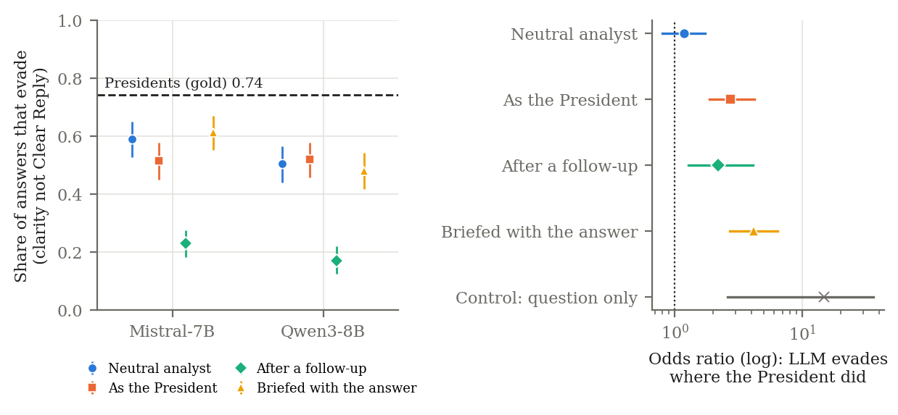
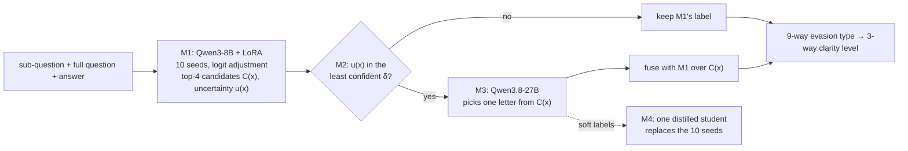

# CLARITY: Unmasking Political Question Evasions

**SemEval-2026 Task 6.** A confidence-routed cascade for classifying evasion in political interviews, and what
it measures: whether evasion lies in the question or in the person answering.

Siddarth Gottumukkula, Vidvathama R, Sanjana Reddy Vonteri, Shashikanta Sahoo<br>
Advanced NLP course project, International Institute of Information Technology, Hyderabad

---

## Overview

Given a journalist's question and a politician's answer, the task is to classify how clearly the answer responds.
Subtask 2 assigns one of nine evasion types (Explicit, Implicit, Dodging, General, Deflection, Partial,
Declining to answer, Claims ignorance, Clarification); Subtask 1 groups them into three clarity levels (Clear
Reply, Ambivalent, Clear Non-Reply). Scoring is macro-F1, where a prediction counts if any annotator gave it.

The project has three parts, each prompted by the one before:

1. **Building an instrument (E0–E23).** On DeBERTa-v3-large, architectural changes (hierarchical heads,
   rebalancing losses, specialist experts, re-rankers, model soups) did not help. Changing only the backbone to
   Qwen3-8B + LoRA gained more than all of them combined (+0.092 per model, 10/10 seeds). That classifier
   *ranks* better than it *decides* (an acceptable label is in its top 3 for 93% of items), so a 27B LLM picks
   among its top four candidates, only for the least confident 30% of items.
2. **What the instrument measures (E24–E25).** One answer often serves several sub-questions, and its label
   changes with the question far more often than annotator noise explains: **evasion is a relation**. The
   instrument reads the question causally (an answer paired with an unrelated question stops being a Clear
   Reply: 25% → 1%). Putting the Presidents' questions to LLMs shows that a model with no stake does not evade
   where the Presidents did, but in the President's role it evades on the same questions (exploratory,
   OR 2.7): **which questions get evaded depends on the role of the person answering**.
3. **Making it cheaper (E26).** FP8 and NF4 versions of the classifier were not faster as implemented, but the
   LLM adjudicator absorbs most of their error: FP8 costs the classifier 0.020 S2 and the full system 0.003.

Every hypothesis was registered before its run, every change was compared against a named control on paired
seeds, and every reported number traces to a script and a raw output file.

## Results (dev, 308 items)

| System | Subtask 2 | Subtask 1 | LLM calls / item | GPU-s / item |
|---|---|---|---|---|
| DeBERTa-v3-large, 10-seed ensemble | 0.405 | 0.648 | 0 | – |
| Qwen3-8B + LoRA, 3 epochs, 10 seeds (mid-evaluation) | 0.543 | 0.746 | 0 | – |
| M1: Qwen3-8B + LoRA, 12 epochs, 10 seeds | 0.598 | 0.743 | 0 | 0.397 |
| **Accuracy point:** M1 + 27B adjudicator, 30% deferred, 4 option orders | **0.650** | **0.788** | 1.43 | 0.538 |
| **Cost point:** distilled student + 27B adjudicator, 50% deferred, 4 option orders (1 order: 0.599, 0.57 calls, 0.098 GPU-s) | **0.608** | **0.785** | 2.30 | 0.266 |
| TeleAI (1st place), multi-stage DeepSeek-V3 pipeline | 0.617 | 0.812 | 1.94 | – |
| One human annotator scored against the other two (2-annotator regime) | 0.684 | – | – | – |

Every system averages seeds and applies logit adjustment; its parameters and the adjudicator's fusion weights
are fitted by nested cross-validation on dev (test labels were never released). With the fusion refitted inside
each bootstrap replicate, the adjudicator's gain over M1 is +0.037 [−0.044, +0.120]. Test predictions are in
`submissions/E23_*`.
LLM calls count every 27B call: with four option orders averaged, one deferred item costs four. GPU-s are
measured on one GPU in one session over the same 308 items (`docs/raw/cost_same_gpu.txt`).

| Research question | Registered test | Result |
|---|---|---|
| Does the instrument read the question causally? (E25a) | Clear-Reply share halves when the question is swapped | **held:** 0.253 → 0.013 |
| Is evasion question-driven? (E25b) | A no-stake LLM evades where Presidents did, OR ≥ 1.5 | **failed:** OR 1.18 |
| Does the President's role matter? (E25b, exploratory) | — | same questions evaded, OR 2.74 [1.87, 4.17] |
| Does pursuit work on LLMs? (E25b) | ≥ 50% of evasions become replies when pressed | **held:** 66% |
| Does the cascade absorb FP8 error? (E26) | ≥ 50% of M1's flips on deferred items, fewer system flips | **held:** 71%; system −0.003 |

<p align="center">
  
</p>

## Method



| Module | Role |
|---|---|
| **M1** Candidate generator | Fine-tuned Qwen3-8B-Base (LoRA) ensemble; outputs the top-4 label set and an uncertainty score |
| **M2** Router | Sends only the δ least confident items onward; the threshold is set on a held-out train slice |
| **M3** LLM adjudicator | A local 27B LLM chooses among M1's four candidates with one output token, averaged over four option orders; fused with M1 |
| **M4** Distillation | M3 relabels train; one student trained on 0.5 · gold + 0.5 · M3 replaces the ensemble |

With every parameter frozen (`code/experiments/e25/frozen_system.json`), the accuracy point is the
**instrument** used in E25 and E26.

## Documentation

| Document | Contents |
|---|---|
| [`docs/findings.md`](docs/findings.md) | **Start here.** The whole project as one argument: every experiment, why it was run, what it showed |
| [`docs/codebase.md`](docs/codebase.md) | Where each code file is, what it does, and its important functions |
| [`docs/reproducing.md`](docs/reproducing.md) | Setup, commands for every analysis and GPU step, hardware and cost |
| [`docs/experiment_log.md`](docs/experiment_log.md) | The pre-registered record: hypotheses, decision rules, amendments and results, E0–E26 |
| [`docs/results_sources.md`](docs/results_sources.md) | Every reported number, with the script and output file it comes from |
| [`docs/scorer_geometry.md`](docs/scorer_geometry.md) | What the multi-reference scorer rewards, and what that implies for decision rules |

## Repository structure

```text
├── code/          source (run every command from here); see docs/codebase.md
├── data/          cached train and dev, the official test file, fixed splits
├── docs/          the documents above; raw/ (every analysis output), figures/
├── logs/          training, queue and cloud-lane logs of every run
├── report/        mid-evaluation report and slides; LaTeX source (latex/)
├── runs/          per-seed probabilities and metrics, 27B records, labels (model weights on Hugging Face)
├── submissions/   Codabench predictions: DeBERTa systems, the cascade (E19_*), the final system (E23_*)
└── paper/         the SemEval-2026 Task 6 results paper (reference)
```

## Getting started

```bash
pip install -r requirements.txt
cd code
python -m preregistered_analyses.e23_systems      # the final operating points, from the tracked runs (CPU)
python -m preregistered_analyses.e25_analysis     # the evasion study
```

Every analysis runs on CPU from the outputs in `runs/`. Training, the 27B adjudicator and the E25/E26 GPU
steps are in [`docs/reproducing.md`](docs/reproducing.md).

## Resources

| | |
|---|---|
| Trained runs and LoRA adapters (Hugging Face) | [huggingface.co/siddarthg44/clarity-semeval26](https://huggingface.co/siddarthg44/clarity-semeval26) |
| Training curves (Weights & Biases) | [wandb.ai/iamsid44-iiit-hyderabad/clarity-semeval26](https://wandb.ai/iamsid44-iiit-hyderabad/clarity-semeval26) |
| Dataset (QEvasion) | [huggingface.co/datasets/ailsntua/QEvasion](https://huggingface.co/datasets/ailsntua/QEvasion) |
| Base models | [Qwen3-8B-Base](https://huggingface.co/Qwen/Qwen3-8B-Base), [Qwen3.8-27B-FP8](https://huggingface.co/Qwen/Qwen3.8-27B-FP8), [DeBERTa-v3-large](https://huggingface.co/microsoft/deberta-v3-large) |

## References

- Konstantinos Thomas, Giorgos Filandrianos, Maria Lymperaiou, Chrysoula Zerva and Giorgos Stamou. 2024.
  [“I Never Said That”: A dataset, taxonomy and baselines on response clarity classification](https://aclanthology.org/2024.findings-emnlp.300/).
  *Findings of EMNLP 2024*.
- Konstantinos Thomas, Giorgos Filandrianos, Maria Lymperaiou, Chrysoula Zerva and Giorgos Stamou. 2026.
  SemEval-2026 Task 6: CLARITY – Unmasking Political Question Evasions. *Proceedings of SemEval-2026*.
